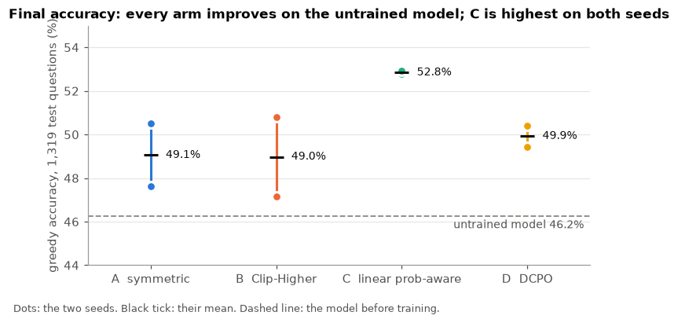
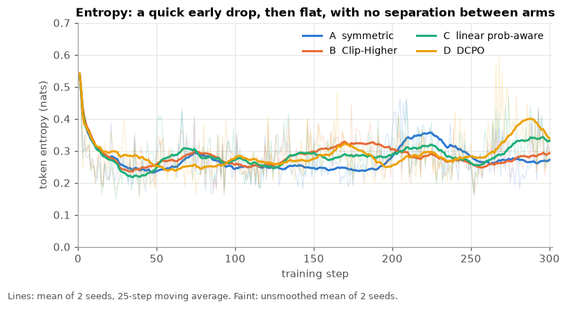
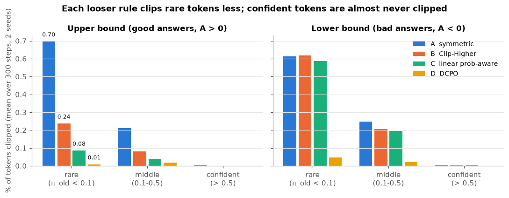
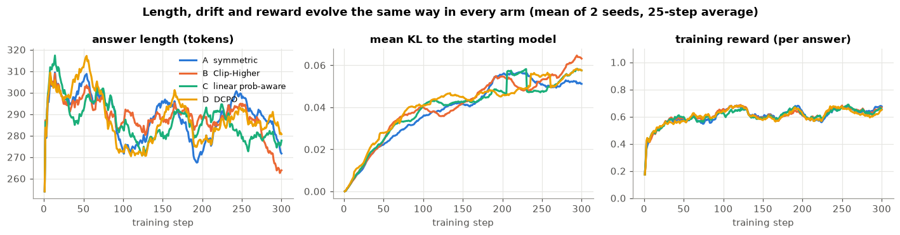
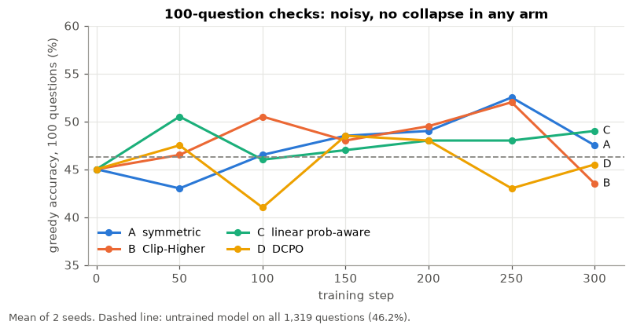

# The effect of the clip rule alone in GRPO: four clip bounds on Qwen2.5-0.5B-Instruct

## TL;DR

- **Why this write-up:** papers that change GRPO's clip rule almost never change it alone. DAPO, for example, ships
  Clip-Higher together with three other techniques and reports their gains stacked, so the clip rule's own effect is
  never isolated. Here the four arms differ **only** in the clip rule, and everything else is held fixed.
- **What I did:** I implemented GRPO from in PyTorch[^claude] and compared four PPO-style clip rules on
  **Qwen2.5-0.5B-Instruct** and **GSM8K**: (A) symmetric, from GRPO; (B) Clip-Higher, from DAPO; (C) a linear
  probability-aware upper bound; and (D) DCPO's square-root bounds. Each arm ran 300 steps with 2 seeds (8 runs on one A10).
- **GRPO works.** All 8 runs beat the untrained model on the full 1,319-question test set: 46.2% → 47.2–52.9%
  (mean 50.2%, +4.0 points).
- **Entropy did not collapse, so there was nothing for the clip rules to prevent.** In every arm, token entropy fell
  from ~0.5 to ~0.28 nats in the first ~10 steps and then stayed flat, and the four arms overlap within the seed
  spread. The main hypothesis could not be tested at this scale.
- **The clip rules behave as designed, but they are a small lever here.** Upper-bound clipping of rare tokens
  ($\pi_{\text{old}} < 0.1$) falls from 0.70% (symmetric) to 0.24% (Clip-Higher), 0.08% (linear) and 0.01% (DCPO),
  yet every rule binds on under 1% of tokens.
- **The linear rule was the most accurate on both seeds** (52.8% and 52.9%, against means of 49.0–49.9% for the other
  arms), but with 2 seeds this is suggestive, not significant ($t \approx 2.3$ against symmetric; $p < 0.05$ needs
  2.78). The loosest rule, DCPO, was no better than symmetric: looser is not monotonically better.

## Motivation and hypothesis

### The problem: clip changes come bundled

This is the main reason I ran this experiment. Papers that change the clip rule almost always change other things at
the same time, so it's hard to tell how much the clip rule itself contributes. DAPO is the clearest example. It
introduces Clip-Higher together with dynamic sampling, a token-level loss and overlong reward shaping, and reports
their gains stacked, each added on top of the previous ones. In AIME 2024 accuracy (%) with Qwen2.5-32B, naive GRPO scores 30; adding overlong filtering gives 36, then
Clip-Higher 38, soft overlong punishment 41, the token-level loss 42 and dynamic sampling 50 (Yu et al., 2025,
Table 1). Clip-Higher's +2 is measured on top of one earlier change and before the rest, so its effect on its own,
or inside the final recipe, is never isolated. DCPO does the same: its new bounds ship with a new advantage
standardization and loss aggregation (Yang et al., 2025). In this repo, the clip rule is the only thing that changes.

### Why the clip bound matters

GRPO keeps PPO's clipped surrogate objective (Schulman et al., 2017; Shao et al., 2024). Each token's probability
ratio $\rho_t = \pi_\theta(o_t \mid q, o_{< t}) / \pi_{\text{old}}(o_t \mid q, o_{< t})$ is clipped to
$[1-\epsilon,\ 1+\epsilon]$: once a token has moved that far in the direction its advantage pushes, it stops
receiving gradient from that batch. The bound is relative, so in absolute terms it treats tokens very differently.
With $\epsilon = 0.2$, a likely token at $\pi_{\text{old}} = 0.9$ can reach ~1.0 in one batch, while a rare token at
$\pi_{\text{old}} = 0.01$ can only reach 0.012. DAPO argues that this is one cause of **entropy collapse**: rare
tokens that open good reasoning paths cannot grow, the policy becomes nearly deterministic, and exploration stops
(Yu et al., 2025).

Several papers change the bound to fix this:

- **Clip-Higher** raises only the upper bound, for every token (Yu et al., 2025).
- **Probability-aware bounds** loosen the bound mainly for rare tokens: linearly in the token's probability
  (Chen et al., 2026), with a square-root rule on both sides (Yang et al., 2025), or with bounds derived from an
  f-divergence trust region (Li et al., 2026).

### What's held fixed

The four arms share one implementation and differ **only** in the clip rule; a unit test checks that the arm configs
differ only in their clip settings. Everything else is held fixed: the model (Qwen2.5-0.5B-Instruct; Qwen Team,
2024), GRPO's group-normalized advantage, the per-answer token average, the KL penalty to the starting model
($\beta = 0.04$), $G = 8$ answers per question, 4 questions per step, $K = 2$ updates per batch, learning rate
$10^{-6}$, weight decay 0, 512-token answers, sampling temperature 1.0, and the same two seeds. $K = 2$ matters: on
the first update $\rho = 1$, so the clip can only act from the second update on.

The published probability-aware results come from larger models and harder benchmarks. This repo adds a controlled
comparison at a smaller scale (0.5B) and an easier task (GSM8K), with the mechanism measured directly: the share of
clipped tokens, split by each token's old probability.

### Hypothesis

I wrote these down before running the experiments. The arms are **A** (symmetric), **B** (Clip-Higher), **C** (linear, probability-aware)
and **D** (DCPO's square-root bounds); [The four clip rules](#the-four-clip-rules) gives their exact bounds.

1. **Minimum:** from-scratch GRPO improves Qwen2.5-0.5B-Instruct on GSM8K over its starting checkpoint.
2. **Entropy:** the probability-aware rules (C and D) keep token entropy clearly above the symmetric rule (A), and at
   least as high as Clip-Higher (B).
3. **Accuracy and stability:** C and D are no worse than A and B in final accuracy, with no more collapses or KL
   blow-ups than A.
4. **Mechanism:** C clips rare tokens ($\pi_{\text{old}} < 0.1$) less than A, while clipping confident tokens
   ($\pi_{\text{old}} > 0.5$) about as often; B loosens every bucket.

If the seed ranges overlap, the conclusion is "no detectable difference at this scale", and it is reported the same
way. With 2 seeds per arm, only large differences can count as real.

## Background

**From RLHF to reasoning.** InstructGPT fine-tuned GPT-3 with Proximal Policy Optimization (PPO) against a reward
model trained on human preference comparisons (Ouyang et al., 2022). PPO's clipped surrogate is a simpler,
first-order stand-in for the KL-constrained trust region of TRPO (Schulman et al., 2015; 2017). In RLHF it still
needs four models in memory: the policy, a frozen reference, the reward model, and a critic as large as the policy.

**Is a trust region needed at all?** RLOO argues that much of PPO's machinery is unnecessary when training starts
from a strong SFT model. Plain REINFORCE on whole answers, where each answer's baseline is the mean reward of the
other answers to the same prompt, with no critic and no clipping, matches or beats PPO in RLHF (Ahmadian et al.,
2024). I don't revisit that question here: I take the clipped objective as given and vary only its bounds.

**GRPO.** Group Relative Policy Optimization drops the critic (Shao et al., 2024). For each prompt $q$ it samples $G$
answers from $\pi_{\text{old}}$, scores them, and uses the group's mean and standard deviation as the baseline and
scale. It keeps PPO's clipped ratio, so each batch can be reused for several updates. Each answer $o_i$ gets one
advantage, shared by all its tokens, and each token $t$ gets a probability ratio:

```math
\hat A_i = \frac{r_i - \mathrm{mean}(\mathbf{r})}{\mathrm{std}(\mathbf{r})},
\qquad
\rho_{i,t} = \frac{\pi_\theta(o_{i,t} \mid q, o_{i, < t})}{\pi_{\text{old}}(o_{i,t} \mid q, o_{i, < t})}
```

The objective for one token is the clipped surrogate minus a KL penalty to the reference model:

```math
\ell_{i,t} = \min\Big(\rho_{i,t} \hat A_i,\ \mathrm{clip}(\rho_{i,t},\ 1-\epsilon,\ 1+\epsilon)\, \hat A_i\Big) - \beta D_{i,t}
```

GRPO maximizes its average, first over the tokens of each answer and then over the $G$ answers:

```math
J(\theta) = \mathbb{E}\left[\frac{1}{G}\sum_{i=1}^{G} \frac{1}{|o_i|}\sum_{t=1}^{|o_i|} \ell_{i,t}\right]
```

Here $D_{i,t}$ is a per-token estimate of $\mathrm{KL}(\pi_\theta \Vert \pi_{\text{ref}})$ and $\beta$ is its weight. The
clip interval $[1-\epsilon,\ 1+\epsilon]$ is the only part this repo changes. Dropping the critic removes a second
network as large as the policy, together with its optimizer state.

**Verifiable rewards.** DeepSeek-R1 scaled GRPO with rule-based rewards: a program checks the final answer of a
math problem or runs the tests of a code problem, so there is no learned reward model to exploit (DeepSeek-AI, 2025).
This repo uses the same kind of reward on GSM8K grade-school math (Cobbe et al., 2021): 0.1 for putting a number in
`\boxed{}`, plus 1 if that number is correct.

**Open problems in the lineage.** Follow-up work fixes failure modes that appear at scale: a length bias from GRPO's
per-answer normalization that lets wrong answers grow long (Liu et al., 2025); entropy collapse, and batches wasted
on groups whose answers all get the same reward (Yu et al., 2025); and instability from noisy per-token ratios,
especially in mixture-of-experts models (Zheng et al., 2025). This repo looks at one lever, the clip bound, and its
link to entropy.

## The four clip rules

Each rule sets the interval $[\text{low},\ \text{high}]$ in $\text{clip}(\rho_{i,t},\ \text{low},\ \text{high})$;
the rest of the objective is unchanged. Here $p = \pi_{\text{old}}(o_{i,t} \mid q, o_{i, < t})$ is the token's
probability under the policy that sampled it.

| Arm | Rule | Lower bound | Upper bound | Source |
|---|---|---|---|---|
| A | Symmetric, $\epsilon = 0.2$ | $0.8$ | $1.2$ | GRPO (Shao et al., 2024) |
| B | Clip-Higher | $0.8$ | $1.28$ | DAPO (Yu et al., 2025) |
| C | Linear, probability-aware ($c = 1$) | $0.8$ | $1 + 0.2(2 - p)$ | upper-only variant of the linear thresholds in Chen et al. (2026) |
| D | Square root (DCPO) | $0.5 + 0.5\sqrt{\max(1 - 0.64/p,\ 0)}$ | $\min\big(0.5 + 0.5\sqrt{1 + 0.8/p},\ 10\big)$ | DCPO's clip rule only (Yang et al., 2025) |

- **Arm C** is $\epsilon_{\text{high}}(p) = \epsilon_0 (1 + c(1 - p))$ with $\epsilon_0 = 0.2$ and $c = 1$: a
  confident token ($p \approx 1$) keeps the symmetric upper bound of 1.2, and a rare token ($p \approx 0$) gets up to
  1.4. Setting $c = 0$ recovers arm A.
- **Arm D** uses DCPO's bounds with $\epsilon_{\text{low}} = 0.16$ and $\epsilon_{\text{high}} = 0.2$. Unlike C,
  **both** bounds move: a confident token gets $[0.8,\ 1.17]$, slightly tighter than symmetric, while a rare token at
  $p = 0.01$ gets $[0.5,\ 5.0]$.

## Setup

**Model and data.** I start from Qwen2.5-0.5B-Instruct and train on the GSM8K training split (7,473 grade-school
math word problems), drawing questions at random each step. I evaluate on the test split (1,319 questions). I picked
the Instruct model on purpose: a base model would get no answer right in many early groups, and a group where every
answer gets the same reward has zero advantage, so it gives no gradient.

**Prompt and reward.** A system prompt asks for the final answer in `\boxed{}`, Qwen's native answer format:
`Solve the math problem step by step. Put the final answer, as a number only, in \boxed{}.` The reward reads the
first number inside the last `\boxed{}` of the answer: 0.1 if there is one, plus 1 if it matches the ground truth.
So a correct answer scores 1.1, a boxed wrong answer 0.1, and an answer with no number in `\boxed{}` scores 0. I first
tried GSM8K's own `#### <number>` format, but Qwen mostly ignored it (6.7% format and 0% accuracy at step 0), and
teaching it a new format would have lowered entropy for reasons that have nothing to do with clipping. With
`\boxed{}`, the untrained model already scores 46.2% on the full test set and puts a number in `\boxed{}` 92.6% of
the time.

**Training.** Each step draws 4 questions and samples 8 answers for each at temperature 1.0 (no top-p or top-k), up
to 512 new tokens. Right after sampling, I compute the token log-probabilities under the sampling policy and under
the frozen reference model, once. Then I make $K = 2$ AdamW updates on those 32 answers. Each update goes over all 32
answers, two at a time to fit in memory, with the gradients added up; then the gradient norm is clipped to 1.0 and
the optimizer steps. The learning rate is $10^{-6}$ and weight decay is 0, so the policy only moves because of the
reward and the KL term (PyTorch's default would be 0.01). The KL coefficient to the starting model is
$\beta = 0.04$, with GRPO's per-token estimator. A run is 300 steps, which is 1,200 question draws with replacement,
about 16% of the size of the training set.

**Choosing the learning rate.** Before the main runs, I tried three learning rates on arm A in short runs: $10^{-6}$,
$3 \times 10^{-6}$ and $10^{-5}$. The two larger ones damaged the model, so every arm uses $10^{-6}$. I didn't tune
anything else.

**Evaluation.** Greedy decoding, pass@1, with the same answer extraction as the reward. Every 50 steps, each run is
scored on a fixed set of 100 test questions; that's only for spotting collapses, since 100 questions carry about
±5 points of noise. At the end, each run is scored on all 1,319 test questions, and that's the number I compare.

**Runs.** 4 arms × 2 seeds (0 and 1) = 8 runs, all from the same commit, on one NVIDIA A10 in fp32 with TF32 matrix
multiplies. The seed decides which questions are drawn and which answers are sampled.

**What's logged.** Every step: reward, accuracy, format rate, answer length and truncation, token entropy, KL to the
reference (the mean and the largest single-token value), the gradient norm, and the clip fraction for the upper and
lower bounds separately, split by the token's old probability ($< 0.1$, $0.1$–$0.5$, $> 0.5$).

## Results

All results come from the 8 runs (4 arms × 2 seeds, 300 steps each). Unless I say otherwise, accuracy is greedy
pass@1 on all 1,319 GSM8K test questions.

### Accuracy



| Arm | Seed 0 | Seed 1 | Mean | Gain over untrained (points) | Format rate (mean) |
|---|---|---|---|---|---|
| Untrained model | | | 46.2% | | 92.6% |
| A: symmetric | 50.5% | 47.6% | 49.1% | +2.8 | 97.6% |
| B: Clip-Higher | 47.2% | 50.8% | 49.0% | +2.7 | 97.6% |
| C: linear, probability-aware | 52.8% | 52.9% | 52.8% | +6.6 | 97.5% |
| D: DCPO | 49.4% | 50.4% | 49.9% | +3.7 | 98.1% |

- **GRPO works.** Every run ends above the untrained model, by +0.9 to +6.7 points (mean +4.0, $t \approx 5.3$
  across the 8 runs). That was the minimum success criterion, and it holds for every clip rule.
- **C is ahead, but not conclusively.** C scored 52.8% and 52.9%, above every run of every other arm (the best other
  run is 50.8%). Against A and B the gap is ~3.8 points.
- **A, B and D are indistinguishable** (49.1%, 49.0% and 49.9%).

**How sure can I be?** With 2 seeds per arm, I estimate the seed-to-seed spread from the 4 pairs of runs, as a pooled
standard deviation with 4 degrees of freedom: 1.68 points. The standard error of a difference between two arm means
is then also 1.68 points, and with 4 degrees of freedom $|t|$ has to exceed 2.78 for $p < 0.05$. For reference, the
binomial standard error of one 1,319-question accuracy near 50% is 1.38 points.

| Comparison | Difference (points) | $t$ |
|---|---|---|
| C − A | +3.8 | 2.26 |
| C − B | +3.9 | 2.30 |
| C − D | +2.9 | 1.74 |
| B − A | −0.1 | −0.05 |
| D − A | +0.9 | 0.52 |

C's lead is suggestive but short of significance, and I made several comparisons, which weakens it further. C's two
seeds also agree almost exactly while A's and B's differ by ~3 points; with 2 seeds, that tight agreement is partly
luck.

### Entropy



Token entropy (nats per token) measures how spread out the model's next-token probabilities are on its own sampled
answers: high means it still considers several continuations, near 0 means it has locked in. It's logged once per
step, averaged over that step's 32 answers, so a single step is noisy.

| Arm | Seed 0 | Seed 1 | Mean over all 300 steps |
|---|---|---|---|
| A: symmetric | 0.268 | 0.273 | 0.270 |
| B: Clip-Higher | 0.283 | 0.278 | 0.280 |
| C: linear, probability-aware | 0.296 | 0.273 | 0.285 |
| D: DCPO | 0.283 | 0.291 | 0.287 |

- **Entropy did not collapse.** In every run it fell from ~0.44–0.64 at the first step to ~0.25–0.30 within about 10
  steps, then stayed flat, and even rose a little over steps 201–300 in most runs.
- **The arms don't separate.** The arm means differ by 0.01–0.02 nats, less than the gap between two seeds of the
  same arm (C: 0.296 vs 0.273). The order C/D > B > A is the direction the hypothesis predicts, but nothing here
  distinguishes it from noise. The numbers per window of training are in the [appendix](#appendix).
- **The early drop is the same in every arm,** and it happens before clipping can matter, since the clip only acts on
  the second of the two updates. It's most likely the model settling on the `\boxed{}` format and its own answer
  style; the format rate rising from 93% to ~98% supports that.

So the main hypothesis is **neither supported nor refuted**: training never reached the entropy-collapse regime that
the hypothesis is about.

### What each rule clipped



The clip fraction is the share of tokens whose ratio $\rho$ moved past the bound in the direction the advantage pushes:
above the upper bound on good answers, below the lower bound on bad ones. It's counted on the second update of each
step, split by the token's old probability, and averaged over the 300 steps and both seeds. This is the direct check
that each rule does what it's designed to do.

| Arm | Upper, rare ($< 0.1$) | Upper, middle | Upper, confident ($> 0.5$) | Lower, rare | Lower, middle | Lower, confident |
|---|---|---|---|---|---|---|
| A: symmetric | 0.70% | 0.21% | <0.01% | 0.61% | 0.25% | <0.01% |
| B: Clip-Higher | 0.24% | 0.08% | <0.01% | 0.62% | 0.21% | <0.01% |
| C: linear, probability-aware | 0.08% | 0.04% | <0.01% | 0.59% | 0.20% | <0.01% |
| D: DCPO | 0.01% | 0.02% | <0.01% | 0.05% | 0.02% | <0.01% |

- **Upper bound, rare tokens:** A clips 0.70%, B 0.24%, C 0.08% and D 0.01%, in that order on both seeds. Each looser
  rule leaves more room for rare tokens on good answers to grow, exactly as designed.
- **Confident tokens are almost never clipped** in any arm. So C's rule (tight for confident tokens) and B's (loose for
  every token) end up doing nearly the same thing here: the difference between "loosen everywhere" and "loosen only
  for rare tokens" never gets exercised.
- **Lower bound:** A, B and C share the same lower bound (0.8) and clip ~0.6% of rare tokens on bad answers. D also
  widens the lower bound and almost stops clipping there (0.05%), so D is the loosest rule on both sides.
- **The scale is small.** Even the strictest arm clips under 1% of rare tokens and ~0.2% of middle ones. Most of every
  update is untouched by the clip rule in every arm, which limits how different the arms could ever be.

### Stability



Three things could explain or undermine an accuracy difference without involving entropy: answer length, how far each arm drifts from the starting model, and training instability.

- **Length is not a confound.** Every arm shortened its answers the same way, from ~300 tokens over the first steps
  to ~270–285 over the last 50. None got longer.
- **Drift is the same.** The mean KL to the starting model rises to ~0.05–0.06 in every arm.
- **Training reward** goes from ~0.56 per answer over the first 50 steps to ~0.65 over the last 50, in all arms alike.
- **Spikes were rare and did no lasting harm.** One step in b-seed0 had a pre-clip gradient norm of 2,602 and a single
  token with a KL of ~46,000; c-seed1 and d-seed1 had one or two smaller spikes (KL ~3,000). Gradient clipping at
  norm 1.0 contained them, and those runs ended at normal accuracy (47.2%, 52.9% and 50.4%). The spikes come from the
  KL penalty's gradient, which grows exponentially for a token the policy has made much less likely than the
  reference. With 2 seeds, no arm is clearly more spike-prone than another.
- **No run collapsed.** The arm means of the 100-question checks every 50 steps stay within ~41–53% (figure in the
  [appendix](#appendix)).

Per-run spike, length and KL numbers are in the [appendix](#appendix).

### Scorecard against the pre-registered criteria

| Criterion | Result | Verdict |
|---|---|---|
| **Minimum:** GRPO improves the model over its starting checkpoint | 46.2% → 47.2–52.9% in all 8 runs, mean +4.0 points | Met |
| **Entropy:** C and D clearly above A, at least as high as B | 0.285 and 0.287 vs 0.270 (A) and 0.280 (B), within the seed spread; no collapse to prevent | Not met (untestable in this regime) |
| **Accuracy:** C and D no worse than A and B | C 52.8% (best), D 49.9%, A 49.1%, B 49.0% | Met |
| **Stability:** no more collapses or KL blow-ups than A | No collapses; isolated spikes in B, C and D runs, all contained | Met (weakly, with 2 seeds) |
| **Mechanism:** C clips rare tokens less than A, confident tokens about the same | Rare: 0.08% vs 0.70%; confident: under 0.01% in both | Met |
| **Length confound:** entropy gains that come with longer answers count less | Same length trend in every arm | No confound |
| **Linear (C) vs square root (D)** | D clips far less than C on both bounds, yet isn't more accurate (49.9% vs 52.8%) and has the same entropy | Looser isn't better |

## Discussion: why entropy didn't collapse

The headline hypothesis was about preventing entropy collapse, and in these runs there was nothing to prevent. I think
three things explain it.

1. **The policy barely moved.** At a learning rate of $10^{-6}$ with 2 updates per batch, the mean KL to the starting
   model was only ~0.05 after 300 steps. The two larger learning rates I tried, $3 \times 10^{-6}$ and $10^{-5}$,
   damaged the model (see the [appendix](#appendix)), so I couldn't simply push harder without changing something
   else.
2. **The clip rule rarely binds.** Even the strictest rule (A) clips under 1% of tokens, and only on the second of the
   two updates, because on the first one $\rho = 1$. A rule that changes under 1% of the update can't reshape entropy
   much when entropy isn't under pressure.
3. **The early drop isn't collapse.** Entropy falls from ~0.54 to ~0.28 in the first ~10 steps in every arm, before
   the clip rule can matter, and then stays flat. That looks like the model settling on the `\boxed{}` format and its
   own answer style (the format rate goes from 93% to ~98%), not like the policy losing its alternatives.

**What about arm C's accuracy lead?** It's the most interesting result and the least certain one: $t \approx 2.3$ with
2 seeds, several comparisons, and no mechanism visible in the logs. C's entropy, length, drift and reward all match
the other arms. I treat it as a lead to replicate, not a finding.

**Looser is not monotonically better.** D relaxes clipping much more than C, on both bounds, yet it doesn't beat A. If
loosening the bound helped through some simple mechanism, D should have done at least as well as C.

**What this does and doesn't show.** At 0.5B on GSM8K, with a learning rate low enough to be stable, training never
entered the entropy-collapse regime that probability-aware clipping is meant to fix, so the clip rule had nothing to
act on. It says nothing about how these rules behave once entropy does start to collapse, for example with longer
training, larger steps, bigger models or harder problems.

## Reproduce

```bash
source setup.sh
python -m pytest -q
```

`setup.sh` creates `.venv`, installs `requirements.txt`, and prints the torch version and the detected device
(CUDA, MPS or CPU). It works on macOS (Apple Silicon) and on Linux GPU machines, and needs Python 3.10+. The tests
cover the loss, the reward and the configs.

The experiment itself needs a CUDA GPU (I used one A10):

```bash
bash scripts/run_all.sh jobs/baseline.txt runs --micro_G 2 --tf32   # untrained model on all 1,319 test questions
bash scripts/run_all.sh jobs/tune.txt runs --micro_G 2 --tf32       # learning-rate check on arm A
bash scripts/run_all.sh jobs/main.txt runs --micro_G 2 --tf32       # the 8 runs: 4 arms x 2 seeds
python scripts/check_runs.py runs                                   # status and summary of every run
```

Each line of a job list is a run name plus its flags. Finished runs are skipped and interrupted ones resume from their
checkpoint, so it's safe to run the same command again. A single run looks like this:

```bash
python -m grpo.train --config configs/arm_c_adaptive_c1.json --seed 0 --run_name c-seed0 --ckpt_dir runs --micro_G 2 --tf32
```

## Appendix

### Learning-rate check

Arm A, 50 steps per learning rate, greedy accuracy on the same 100 test questions:

| Learning rate | Step 0 | Step 25 | Step 50 |
|---|---|---|---|
| $10^{-6}$ | 45% | 42% | 44% |
| $3 \times 10^{-6}$ | 45% | 48% | 38% |
| $10^{-5}$ | 45% | 24% | 28% |

With 100 questions, each number is uncertain by about ±5 points, but the drops to 24–28% at $10^{-5}$ and to 38% at
$3 \times 10^{-6}$ were enough for me to stay at $10^{-6}$.

### Entropy by window of training

Mean token entropy (nats) over each window of steps:

| Run | Steps 1–25 | 26–100 | 101–200 | 201–300 | All 300 |
|---|---|---|---|---|---|
| A, seed 0 | 0.284 | 0.273 | 0.246 | 0.282 | 0.268 |
| A, seed 1 | 0.265 | 0.242 | 0.263 | 0.309 | 0.273 |
| B, seed 0 | 0.274 | 0.281 | 0.297 | 0.274 | 0.283 |
| B, seed 1 | 0.256 | 0.261 | 0.295 | 0.280 | 0.278 |
| C, seed 0 | 0.268 | 0.287 | 0.292 | 0.315 | 0.296 |
| C, seed 1 | 0.250 | 0.260 | 0.264 | 0.297 | 0.273 |
| D, seed 0 | 0.296 | 0.281 | 0.264 | 0.301 | 0.283 |
| D, seed 1 | 0.295 | 0.242 | 0.286 | 0.332 | 0.291 |

### Accuracy during training



Every 50 steps, each run was scored on the same 100 test questions. With 100 questions, one run's accuracy is
uncertain by about ±5 points, more than every effect in this study, so these curves are only for spotting collapses.
They also disagree with the full test set in places: C's seed 1 scored 46% on the 100 questions at step 300, but
52.9% on all 1,319.

### Per-run stability numbers

| Run | Max grad norm (pre-clip) | Max per-token KL | Steps with per-token KL > 1,000 | Length, last 50 steps | Mean KL, last 100 steps |
|---|---|---|---|---|---|
| a-seed0 | 4.5 | 250 | 0 | 281 | 0.050 |
| a-seed1 | 10.0 | 666 | 0 | 280 | 0.055 |
| b-seed0 | 2,602.3 | 45,761 | 1 | 270 | 0.053 |
| b-seed1 | 7.2 | 462 | 0 | 275 | 0.057 |
| c-seed0 | 5.1 | 478 | 0 | 274 | 0.055 |
| c-seed1 | 22.3 | 3,007 | 1 | 282 | 0.053 |
| d-seed0 | 9.0 | 864 | 0 | 285 | 0.049 |
| d-seed1 | 13.6 | 2,976 | 2 | 279 | 0.059 |

### Systems profile


These numbers come from the training logs. A proper breakdown of where the time goes needs an instrumented run,
which I haven't done yet (see the end of this section).

**Hardware.** Everything ran on one NVIDIA A10 (24 GB), with PyTorch 2.14 and CUDA 13.0. Weights are fp32, and
matrix multiplies use TF32.

**Memory.** The policy and the frozen reference are about 2 GB each in fp32. The policy's gradients add another
~2 GB and AdamW's two moment buffers ~4 GB, so roughly 10 GB is used before any activations. The rest of the card
goes to activations and to the logits over Qwen's 152k-token vocabulary, which is why each forward and backward pass
handles 2 answers at a time (`--micro_G 2`).

**Time.** A step takes about 35 s on average (21–47 s, depending on how long the answers are). A 300-step run takes
~2.9 hours, and the 8 runs took ~23 A10-hours of training, plus roughly 13 minutes for each final 1,319-question
evaluation. End to end, that's ~265 generated tokens per second: 32 answers of ~287 tokens every ~35 s.

**Not measured yet.** The logs only have the total time per step. To see where the 35 s go, I plan a ~20-step
instrumented run with CUDA-synchronized timers around sampling, the old-policy and reference forward passes and the
two updates, plus `torch.cuda.max_memory_allocated`. That gives the split between generating answers and updating
the model, the tokens per second of each phase, and peak memory.

### Implementation notes

A from-scratch implementation of **Group Relative Policy Optimization** (GRPO,
[Shao et al. 2024](https://arxiv.org/abs/2402.03300)) in plain PyTorch, trained on GSM8K. No RL library
is used: `transformers` loads the models and runs generation, and everything else is written here.

#### Layout

```
grpo/
  data.py         GSM8K loading, chat-template prompt with the \boxed{} instruction
  reward.py       answer extraction from the last \boxed{} and the reward
  sampling.py     group generation, masks, per-token log-probs and entropy
  loss.py         advantages, the four clip rules, GRPO loss, clip counting by old-probability bucket
  eval.py         greedy pass@1
  checkpoint.py   save and resume
  logger.py       per-step CSV metrics
  utils.py        device selection, seeding
  train.py        config, training loop, logging, evaluation
configs/          one JSON config per arm (they differ only in the clip settings)
jobs/             job lists for the baseline, the learning-rate check and the 8 main runs
scripts/          run_all.sh (runs a job list back to back, resumable), check_runs.py (status and summary)
tests/            unit tests for the loss, the reward and the configs
figures/          the plots in this README
run_book.ipynb    a step-by-step walk through one GRPO step with the code in grpo/
setup.sh          environment setup
requirements.txt
```

#### Details worth knowing

- **One branch per clip rule.** `clip_bounds` in `loss.py` returns each token's lower and upper bound from its old
  log-probability. The four modes are `symmetric` (A), `decoupled` (B, Clip-Higher), `prob_adaptive` (C) and `dcpo`
  (D). A new rule is one more branch plus one config file.
- **Old-policy and reference log-probs are computed once per step,** right after sampling and without gradients, and
  both updates reuse them.
- **Memory.** Answers go through forward and backward two at a time (`--micro_G 2`), and each chunk's loss is weighted
  so the summed gradient equals the gradient of the whole batch.
- **A built-in precision check.** Before the first update, the code asserts that every ratio is within $10^{-3}$ of 1,
  which also confirms that TF32 doesn't distort the ratios.
- **Extra logging.** Besides the usual metrics, every step logs the largest single-token KL and the clip counts for
  each old-probability bucket.
- **Reproducible runs.** Each run folder stores its config, the git commit, `pip freeze` and per-step CSVs, and an
  interrupted run resumes from its last checkpoint.

## References

- Ahmadian et al. 2024. *Back to Basics: Revisiting REINFORCE Style Optimization for Learning from Human Feedback in
  LLMs* (RLOO). [arXiv:2402.14740](https://arxiv.org/abs/2402.14740)
- Chen et al. 2026. *Flexible Entropy Control in RLVR with a Gradient-Preserving Perspective.*
  [arXiv:2602.09782](https://arxiv.org/abs/2602.09782)
- Cobbe et al. 2021. *Training Verifiers to Solve Math Word Problems* (GSM8K).
  [arXiv:2110.14168](https://arxiv.org/abs/2110.14168)
- DeepSeek-AI 2025. *DeepSeek-R1: Incentivizing Reasoning Capability in LLMs via Reinforcement Learning.*
  [arXiv:2501.12948](https://arxiv.org/abs/2501.12948)
- Li et al. 2026. *BandPO: Bridging Trust Regions and Ratio Clipping via Probability-Aware Bounds for LLM
  Reinforcement Learning.* [arXiv:2603.04918](https://arxiv.org/abs/2603.04918)
- Liu et al. 2025. *Understanding R1-Zero-Like Training: A Critical Perspective* (Dr. GRPO).
  [arXiv:2503.20783](https://arxiv.org/abs/2503.20783)
- Ouyang et al. 2022. *Training Language Models to Follow Instructions with Human Feedback* (InstructGPT).
  [arXiv:2203.02155](https://arxiv.org/abs/2203.02155)
- Qwen Team 2024. *Qwen2.5 Technical Report.* [arXiv:2412.15115](https://arxiv.org/abs/2412.15115)
- Schulman et al. 2015. *Trust Region Policy Optimization.* [arXiv:1502.05477](https://arxiv.org/abs/1502.05477)
- Schulman et al. 2017. *Proximal Policy Optimization Algorithms.* [arXiv:1707.06347](https://arxiv.org/abs/1707.06347)
- Shao et al. 2024. *DeepSeekMath: Pushing the Limits of Mathematical Reasoning in Open Language Models* (GRPO).
  [arXiv:2402.03300](https://arxiv.org/abs/2402.03300)
- Yang et al. 2025. *DCPO: Dynamic Clipping Policy Optimization.* [arXiv:2509.02333](https://arxiv.org/abs/2509.02333)
- Yu et al. 2025. *DAPO: An Open-Source LLM Reinforcement Learning System at Scale.*
  [arXiv:2503.14476](https://arxiv.org/abs/2503.14476)
- Zheng et al. 2025. *Group Sequence Policy Optimization* (GSPO). [arXiv:2507.18071](https://arxiv.org/abs/2507.18071)

[^claude]: I got a lot of help from Claude, Anthropic's AI assistant, throughout this project: with the
    implementation and the code, with the documentation and this write-up, and with the ideas behind the experiment.
